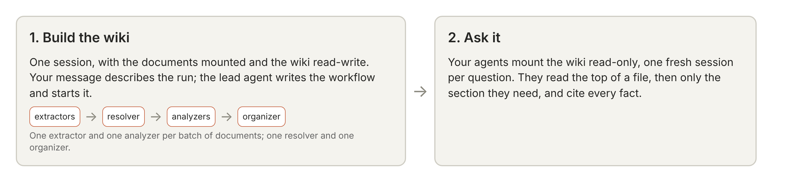

# Knowledge wiki: my run of Anthropic's quickstart

This repo holds the [knowledge-wiki quickstart](https://github.com/anthropics/claude-quickstarts/tree/main/managed-agents/knowledge-wiki)
from `anthropics/claude-quickstarts`, used under its MIT license (see `LICENSE`), run end to end on the
`core` tier for DAMG 7245, plus a small web demo in `demo/` that asks the built wiki questions.

What I changed from the quickstart as shipped:

- `distill_documents_into_knowledge_wiki.ipynb`: no code changes. Its saved outputs are now from my run
  instead of the recorded one, so every number below can be checked in the notebook.
- `.gitignore`: added `.venv/` and `.DS_Store`.
- `demo/`: new (see [Run the demo](#run-the-demo)).

The quickstart's own README follows mine, unchanged.

## What I ran

- Corpus: the `core` tier, 8 SEC filings fetched from EDGAR plus the quickstart's 2 synthetic example files:
  10 documents, split into 29 files in 25 batches. The optional board deck was not fetched.
- Models: `claude-haiku-5-5` for extraction, consolidation and the wiki questions; `claude-sonnet-5-5` for the
  lead agent and the raw-documents baseline.
- Build budget: $30 (`COOKBOOK_BUDGET_USD`).

## Results

All figures are from the notebook's saved outputs; the section of the notebook each comes from is named.

| What | My run | Notebook section |
| --- | --- | --- |
| Build cost, estimated before running | $25.77 | The consolidation prompts |
| Build cost, as the platform metered it | $18.86 | Build cost by agent |
| Build time | 30.5 minutes | Run the build |
| Batches extracted / analyzed | 25 / 25, no failures | Run the build (the lead agent's report) |
| Open questions resolved / unresolvable / still open | 10 / 0 / 294 | Run the build (the lead agent's report) |
| Index entries | 219 | Run the build (the lead agent's report) |
| Wiki size | 221 files, 1,257,528 bytes; `_schema.md` unchanged | Read the wiki |

Checks on the build (Check what ran): all 17 checks on the platform's records passed (52 threads, each phase
started after the last one ended, every one of the 25 inputs read by an extractor and by an analyzer), and no
document went unfiled. The file check on the wiki found no stubs, no unindexed files and no missing index
entries; it did find 1 dangling link and 6 files whose front-matter name doesn't match the file name.

Wiki against raw documents, on the notebook's 6 held-out questions (What it costs):

| | Mean cost per question, from tokens at list prices |
| --- | --- |
| With the wiki (`claude-haiku-5-5`) | $0.004 |
| Searching the raw documents (`claude-sonnet-5-5`) | $0.058 |

The wiki was cheaper on all 6, by $0.027 to $0.094 per question, so on cost alone the $18.86 build breaks even
after about 349 questions. Six questions are a sample, not a benchmark; the answers themselves are in the
notebook, collapsed under What it costs.

<!-- TODO (Preksha): say whether the answers were right, after checking them against the answer key in the
     comments of the BATTERY list in the What it costs cell. -->

## Run the demo

`demo/` is a FastAPI app with one page: type a question (or pick one of the notebook's four) and get the wiki's
answer with its sources, and what it cost. Each question opens a fresh session with the wiki mounted
read-only, as the notebook's `ask` does, and the session is archived when the answer is in.

It needs a wiki built by the notebook and kept (the clean-up cell keeps it unless `COOKBOOK_KEEP_WIKI=0`).

```bash
pip install -r demo/requirements.txt
python demo/setup_demo.py        # once: creates the demo's agent and environment, prints two .env lines
```

Add to `.env` (never committed):

```
WIKI_STORE_ID=memstore_...        # printed by the notebook's clean-up cell
DEMO_ENVIRONMENT_ID=env_...       # printed by setup_demo.py
DEMO_AGENT_ID=agent_...           # printed by setup_demo.py
```

Then run it and open http://127.0.0.1:8000:

```bash
uvicorn demo.app:app --host 127.0.0.1 --port 8000
```

When you're done: `python demo/teardown_demo.py` archives the demo's agent and environment and keeps the wiki.

## Generative-AI use

<!-- TODO (Preksha): write this section yourself, following the course's policy. -->

---

# Knowledge wiki with a dynamic workflow

*A knowledge wiki for agentic retrieval that keeps its sources and its conflicts. For developers whose agents answer repeated questions over a slow-changing set of documents. A tutorial: run it top to bottom once on the worked example, then point it at your own corpus.*



This quickstart reads a corpus **once** into a knowledge wiki, plain markdown in a Claude Managed Agents memory store, then answers from the wiki. Provenance sits on every fact, conflicts between documents stay conflicts, and superseded figures stay superseded.

When agents search documents, every question starts from scratch, and the facts between documents aren't in any single passage. With the wiki, a small model answers within a point of a larger model that searches the raw documents with no wiki, at about 1/15 of the price per answer, and about 3 points better than it does searching the documents itself. The wiki costs about $19 to build once on the benchmark's average (the run recorded in the notebook cost about $16) and, on the benchmark's figures, pays for itself after about 240 questions against that larger model. The notebook measures these costs on your own run.

The build is one Managed Agents session running one **dynamic workflow**, described in one message.

The pattern fits any slow-changing corpus that agents query repeatedly: M&A due diligence (the worked example), legal discovery, support over product docs.

**Just reading?** Every cell in the notebook ships with the real output from the recorded run. You can read it top to bottom as a worked case study without running anything.

## The corpus

The worked example is a real, completed take-private deal, using public SEC filings fetched live from EDGAR. The filings themselves are not included. Two small files, marked as synthetic, stand in for internal documents; one gives an EBITDA estimate on a different basis from the company's reported figure, so you can watch the wiki keep the two apart.

To build from your own documents, set `COOKBOOK_DOCS` to a folder of provenance-stamped `.txt` files; `kw.normalize_any` converts PDFs, Word, Excel, PowerPoint and email to text. Office files from a counterparty are untrusted input: convert them in a container or on a machine you don't mind exposing to a malformed file, or convert them to text first with a tool you trust.

## What's inside

| file | what it is |
| --- | --- |
| `distill_documents_into_knowledge_wiki.ipynb` | the notebook: run top to bottom |
| `prompts/` | the consolidation method (`analyzer_system.md`, `organizer_system.md`, each ending in an instructions block the notebook fills when it creates the agents), the lead agent's prompt (`lead_system.md`, with the run's standing rules and the report's shape) and the baseline analyst's prompt (`baseline_system.md`) |
| `utilities.py` | the notebook's functions: uploads, session exports, following and stopping a workflow run, checks on what ran, memory-store copies and exports, pricing |
| `build_manifest.py` | queries SEC EDGAR, writes the size-tiered document manifests (`manifest_core.json`, the default tier, is a fixed list that ships here) |
| `fetch_data_room.py` | downloads the filings for a tier and converts to provenance-stamped text |
| `fetch_real_deck.py` | downloads a real board deck (scanned slides from 13E-3 exhibits) into a PDF |
| `make_analyst_docx.py` | generates the marked-synthetic Word analyst note |
| `example_data/` | the synthetic companions (analyst note, vendor CSV) |
| `requirements.txt` | the Python packages the notebook and scripts need |

## How it works

1. **Build the wiki.** A workflow run gives each batch of documents to an extractor. A resolver then works the top gaps the extractors flagged, and the consolidation follows: analyzers check what was filed against the documents, and an organizer tidies the whole wiki.
2. **Ask it.** Your agents mount the wiki read-only, one session per question, and cite every fact.

The notebook also checks what ran against the platform's records, measures what a question costs with the wiki and without it, and points to the dreaming cookbook for keeping the wiki current from your agents' transcripts.

## Access

Everything runs on **Managed Agents** (beta), which provides the memory stores, agents, sessions and dynamic workflows and is enabled by default for API organizations; the SDK sends the beta headers. If `client.beta.agents.create` returns a permission error, ask your organization's admin. The notebook needs Python 3.11 or later and the public `anthropic` Python SDK, version 2.0 or later, which `requirements.txt` installs.

## Quickstart

The fastest path is to let Claude drive the setup:

```bash
cd managed-agents/knowledge-wiki
claude "walk me through setting up the knowledge-wiki quickstart"
```

Or follow the steps by hand:

```bash
pip install -r requirements.txt

export EDGAR_USER_AGENT="your-name your-email"   # SEC asks for a contact

python3 fetch_data_room.py --tier=core   # 8 filings, 2.8 MB text: the recorded run (or --tier=quickstart)
python3 fetch_real_deck.py               # optional: 6 slides of a real board deck (~1 MB) for the normalize step
python3 make_analyst_docx.py             # optional: regenerates example_data/analyst_note.docx, which ships here
# All five manifests ship with the folder. build_manifest.py is an optional refresh from EDGAR that
# rewrites the quickstart, mini, standard and full manifests (never core); run it before fetching, not after.

jupyter lab distill_documents_into_knowledge_wiki.ipynb
```

Authentication follows the standard Anthropic credential chain. Construct the client with no credential arguments and it picks up whichever of `ANTHROPIC_API_KEY` (in the environment or a `.env` file here), an `ant auth login` profile (the [`ant` CLI](https://platform.claude.com/docs/en/cli-sdks-libraries/cli/authentication), version 2.0 or later), or Workload Identity Federation applies to you.

Run records go to a new folder under your system's temporary directory (`/tmp/knowledge_wiki-<uid>/runs/` on Linux), readable only by you, which most systems clear when the machine restarts. Set `COOKBOOK_RECORDS_DIR` to keep them somewhere lasting.

## Cost and tier expectations

- The recorded run on the default `core` tier (8 filings, 2.8 MB of text) took 23 minutes and cost about $16 at list price.
- It used the default models: Claude Haiku 5.5 for the agents that read, Claude Sonnet 5.5 for the lead agent and the raw-documents baseline.
- Only `core` was recorded. For any other tier or your own folder, the notebook prints a list-price estimate before it builds and stops if that is over your budget. Your run will vary with model, corpus and current pricing.

The other tiers:

- `quickstart`: 8 short filings around the deal.
- `mini`: 26 filings, less text than `core`.
- `standard`: 37 filings.
- `full`: all 42 from the deal window, which leaves out `core`'s FY2022 annual report.

Empty `data_room/docs` before you fetch a different tier: the build reads whatever is in the folder, and the fetch script stops if it finds another tier's files there.

- **File size:** a file in the store is capped at 100 KB. On a larger corpus the main company's entity page and the red-flags file (`escalations.md`) reach that sooner and have to be split into linked files.
- **Shared pages:** agents write straight onto shared pages, so they sometimes overwrite each other: about 5% of the lines filed to the busiest entity page lose content. We accept that because a shared page brings figures from different documents together, where agents can flag disagreements.
